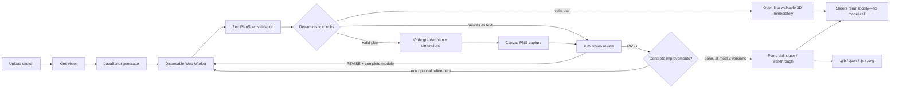

# Sketch to Walkthrough

**Drawn by you. Brought to life in the browser.**

An open-source Vite + React + Three.js app that turns a floor-plan sketch into an editable, walkable 3D home. Kimi reads the drawing and writes a small layout generator. A deterministic engine—not the vision model—checks its work.

The renderer is fixed. Kimi controls the layout, not your camera, browser, or Three.js scene.


## Run it

Requires Node.js 20.19+ or 22.12+ (tested on Node 24). No database.

```sh
npm install
cp .env.example .env   # add your NEBIUS_API_KEY
npm run dev
```

Open **http://localhost:5180**. The model server listens on **8787**. The Vite port is fixed so another local project won't silently receive requests.

```dotenv
NEBIUS_API_KEY=your_key_here
NEBIUS_BASE_URL=https://api.tokenfactory.nebius.com/v1
MODEL=moonshotai/Kimi-K3.1-Pro
PORT=8787
```

`.env` is gitignored. **The key is read only by `server/index.js`, never sent to the browser.** `.env.example` intentionally has no key. Images go from the browser to the local server, then to the configured model provider. There is no database or server-side disk storage of sketches; navigating away loses the session.

Three original generated PNG samples are included in `public/samples`. Click an image to run the complete model loop, or its round arrow for an instant local two-bedroom example. Regenerate sketches with `npm run samples` (local Playwright Chromium).

## The generate → check → render → review loop



1. **Generate.** `prompts/generate.md` instructs the vision model to read written dimensions, convert to millimetres, and export exactly `PARAMS`, `ASSUMPTIONS`, and `buildPlan`.
2. **Build safely.** Each slider change or revision runs in a newly-created disposable module Web Worker. Acorn source validation allows pure computation, `Math`, and `Number`; imports, ambient network/DOM globals, dynamic code, prototype access, and mutation are rejected. The parent terminates a worker after **500 ms**.
3. **Repair, validate, and check.** Deterministic local repairs clamp out-of-range parameter defaults into their inclusive bounds and link or detach incomplete assumption references; every repair is listed on that version in Checks. Zod validates `PlanSpec`, then independent checks cover the closed exterior, room geometry, openings, and entry-to-room access. Structural, execution, schema, and engineering failures go into review rather than being hidden by local repair.
4. **Render.** The fixed SVG plan builder draws the orthographic plan, room names and areas, wall openings, door swings, and overall dimension lines. It is rasterised through a browser canvas to PNG for the vision reviewer; the plan tab displays the same SVG.
5. **Explore while review runs.** The first version that passes validation and all engineering checks opens immediately in the walkable viewer; the full-screen generation overlay no longer blocks it. `prompts/review.md` continues in the background with the original sketch, render, checks, and source. A valid revision joins the version switcher with a “newer version available” notice without changing the current camera or selected version. Invalid revisions remain inspectable while a valid earlier version stays navigable. The app keeps up to **three versions**, and a PASS permits **one optional refinement**.
6. **Explore and adjust.** Sliders rerun `buildPlan` locally. Walls, polygons, openings, and entry derive from the same numeric values. Assumptions link to their sliders. Versions and their in-session edits are switchable.

The server streams `POST {NEBIUS_BASE_URL}/chat/completions`. If a generation stream dies, it sends the partial answer and asks the model to continue, for up to three stream segments. The debug panel shows actual returned completion tokens, elapsed time, and tokens/sec. It does not invent missing usage.

### Swap models with one env var

```dotenv
MODEL=another-vision-model-on-nebius
```

Restart the server. The replacement must support Nebius's OpenAI-compatible chat-completions format, streamed SSE, and `image_url` data-URL parts. `NEBIUS_BASE_URL` selects another compatible gateway. Generation uses `low` reasoning effort by default and review uses `medium`. Override them with `GENERATE_REASONING_EFFORT` and `REVIEW_REASONING_EFFORT` if a model needs a different setting. The generation prompt asks for compact, comment-free helpers and a focused parameter set.

## Generator contract

All PlanSpec dimensions are **mm**, origin bottom-left, plan Y upward. Three.js geometry is in metres; plan Y maps to world −Z.

```js
export const PARAMS = {
  wall_height: { value: 2700, min: 2400, max: 3300, group: "global", label: "Wall height" },
  living_width: { value: 5000, min: 4000, max: 6000, group: "room", room: "living", label: "Living width" }
};
export const ASSUMPTIONS = [
  { id: "height", text: "No height was written; a residential default is used.", param: "wall_height" }
];
export function buildPlan(P) {
  // P is { wall_height: 2700, living_width: 5000 }.
  // Derive all geometry from P, never hardcode adjustable dimensions.
  return {
    wallHeight: P.wall_height,
    walls: [/* { id, a, b, thickness, exterior } */],
    rooms: [/* { id, name, polygon, floor } */],
    openings: [/* { id, wallId, type, offset, width, height, sill?, swing? } */],
    entry: { position: [1000, 1200], facing: 0 }
  };
}
```

Bounds are inclusive: `min <= value <= max`, with `min < max` and positive minima. Up to 100 flat numeric parameter entries. Room parameters reference a room ID. `offset` is measured from a wall's `a` endpoint. Doors/openings connect room polygons; windows do not. Entry facing is clockwise degrees from north: `0` faces +Y, `90` faces +X.

The prompts ask for realistic narrow ranges and coupled geometry, not redundant coordinate sliders. Invalid edits are exposed in Checks rather than silently distorting construction. `ASSUMPTIONS[].param` is optional: a missing reference is linked only when its name matches exactly one parameter; otherwise the assumption remains text-only. Original assumption text and values stay visible beside current slider values.

## Deterministic checks

- One connected exterior loop, degree two at corners. No duplicate, zero-length, intersecting, or overlapping walls; T-junctions are allowed.
- Simple, nonzero, non-self-intersecting room polygons; no overlapping rooms; vertices inside the exterior envelope.
- Valid opening references, 100 mm minimum margin at both wall ends, no overlapping openings, no opening through the wall top.
- Doors at least 800 mm wide at floor level. Window sills between 600 and 1100 mm.
- Entry-to-room graph traversal through doors/openings. Rooms named hall/corridor/passage have a 900 mm clearance check.
- Min/max stored per parameter, with actual rebuild validation after edits.

These checks are for exploration, **not structural, building-code, fire-safety, accessibility, or construction certification**. Hallway checking is oriented toward straight rectangular halls; unusual concave corridors may be conservatively rejected.

## Viewer and exports

- **Plan:** dimensioned, labelled orthographic drawing.
- **Dollhouse:** orbit/pan/zoom with roof off, hemisphere + directional shadow lighting, and screen-sized room labels that remain readable at the default zoom.
- **Walkthrough:** pointer lock, WASD/arrow keys, Shift to move faster, mouse look, Escape. Eye height **1600 mm**. A 210 mm body radius checks wall segments while allowing passage through door/opening clear spans, not windows. Spawn selection seeks roughly **1000 mm clear of wall surfaces**, faces into the selected room, and uses the existing collision test. If a narrow entry hall cannot provide that clearance, the nearest safe room is used instead. Labels use wall depth testing, so only the current or directly visible rooms show through the camera view. Touch-move joystick and drag-to-look are included.
- Walls are solid segments around real holes; no CSG dependency. Glass, frames, ajar doors, per-room floor materials, and first-person ceilings derive from `PlanSpec`.
- Downloads: metre-scaled GLB from `GLTFExporter`, `plan.json`, `plan.js` with current defaults substituted into the AST-identified `PARAMS` object, and `plan.svg`.

## Project map

```text
server/index.js           Hono routes, key handling, stream continuation, telemetry
prompts/                  Separate generation and review prompts
src/lib/plan.ts           Zod PlanSpec, parameters, assumptions
src/lib/module.ts         Acorn validation and generator evaluation
src/lib/plan.worker.ts    Disposable browser build sandbox
src/lib/checks.ts         Deterministic engineering checks
src/lib/plan-svg.ts       Orthographic SVG and canvas PNG rasterisation
src/lib/world.ts          Three.js walls, openings, floors, doors, glass, labels
src/three/PlanViewer.tsx  View modes, input, label sizing and camera
src/lib/walkthrough.ts     Collision, safe spawn selection and sight-line facing
src/App.tsx               Model/version orchestration and studio
public/samples/           Three original generated sketch PNGs
scripts/browser-check.mjs Full-Chromium browser checks
scripts/model-check.mjs   Real, unmocked end-to-end model verification
scripts/generation-check.mjs Real generation checks on all three samples
```

## Tests and verification commands

```sh
npm test              # Validator, sandbox restrictions, checks, slider bounds
npm run build         # TypeScript and production Vite build
npm run qa            # Start npm run dev first; browser evidence in screenshots/
npm run verify:model       # REAL two-bedroom generate/review loop; NEBIUS_API_KEY required
npm run verify:generation  # REAL generation-only checks on all three samples
```

QA prefers `~/Library/Caches/ms-playwright/chromium-1234/chrome-mac-arm64/Google Chrome for Testing.app`, falling back to Playwright's browser lookup. It uses full Chromium, not headless-shell. Screenshots and evidence stay in gitignored `screenshots/`. Unit tests never call the model. The real verification script drives the user-facing generate/review flow and records returned code, verdicts, issues, usage, and total time without mocking.

## Verification

### Checked locally

- `npm test`: **45 tests passed**, covering PlanSpec and source rejection, inclusive parameter bounds, deterministic clamp and assumption repairs, pure nested/private helpers, invalid wall/polygon/opening cases, reachability, safe walkthrough spawn, all individual sample bounds, and accumulated minima/maxima.
- `npm run build`: TypeScript and the production Vite build passed.
- Full-Chromium desktop and mobile screenshots were captured and visually inspected at **1440, 1280, and 390 px**. Hero annotation overlap checks passed at all three sizes.
- The final desktop/mobile browser run passed **43/43 checks**: three modes, readable screen-sized labels, wall-occluded walkthrough labels, parameter-driven geometry, movement and pointer-lock release, mobile joystick, original/current assumption values, visible local repair notes, downloads, and overflow.
- Browser-only mocked model responses proved that v1 is visible and usable before review returns, local repairs are shown in Checks, and a revised v2 appears without switching away from the v1 walkthrough. These checks do not call the real model.
- Sample worker builds measured **10.3–11.9 ms** in the final run, excluding browser rendering/automation. A deliberately non-terminating generator was killed at **501.4 ms**.
- The sample spawned in Bedroom 01 with **1100 mm** clearance from the nearest wall surface and **1160 mm** to its centreline, comfortably beyond the 900 mm browser-check threshold.
- Downloaded `.glb` was checked for its binary glTF signature. `.json`, `.js`, and `.svg` downloads were saved, and the exported plan contained edited geometry.

### Reasoning-effort check (real generation calls)

Generation-only runs used all three original sample PNGs and executed the returned source through the actual builder. `none` returned zero reasoning tokens and much smaller modules, but none of these three final `none` responses passed every engineering check. `low` passed all three after replay through the corrected helper-scope validator. This is why the default remains **low**, not `none`.

| Effort | Sample | API time | Completion tokens (reasoning) | Tokens/sec | Builder + engineering result |
|--------|--------|----------|-------------------------------|------------|------------------------------|
| none | two-bedroom | 121.6s | 2,113 (0) | 17.4 | Door margin and reachability failures |
| none | studio | 23.9s | 1,800 (0) | 75.3 | Room reachability failure |
| none | garden-flat | 25.7s | 1,915 (0) | 74.6 | Overlapping windows |
| low | two-bedroom | 80.0s | 5,645 (3,729) | 70.6 | All four check groups passed |
| low | studio | 59.7s | 4,714 (3,126) | 79.0 | All four check groups passed |
| low | garden-flat | 77.4s | 5,577 (3,651) | 72.1 | All four check groups passed |

The replay was offline and used the final Acorn scope handling; it corrected false rejections of pure named/private helpers without allowing assignments, default parameters, or ambient globals. Evidence: `screenshots/generation-verification.json`, `screenshots/generation-none-final.json`, and `screenshots/generation-replay.json`. Replay with `node --experimental-strip-types scripts/replay-generation.ts`; it makes no model requests.

### Real model verification

Tested on 2026-11-05 with `moonshotai/Kimi-K3.1-Pro` on Nebius Token Factory, reading the **two-bedroom sample sketch**. Three real requests produced two retained versions. Generation used `low`; both reviews used `medium`.

| Call | Phase | API duration | Completion tokens (reasoning) | Tokens/sec | Result |
|------|-------|--------------|-------------------------------|------------|--------|
| 1 | Generate v1 | 127.4s | 7,570 (5,710) | 59.4 | Valid v1; all four engineering groups passed and the viewer opened before review |
| 2 | Review v1 | 310.6s | 16,766 (14,526) | 54.0 | REVISE: door positions/swings and window placement observations |
| 3 | Review v2 | 208.5s | 5,362 (5,334) | 25.7 | **PASS**, no remaining issues or improvements |

**Time to first walkable:** **127.9s app time / 131.0s wall time**. This was v1, before its vision review completed. **Time to final v2:** **650.5s wall time** (about 10 minutes 51 seconds); the three API calls account for **646.5s** of that flow. The two medium reviews account for **519.1s**, so background review dominates final completion time. The version-2 state and screenshots report a rounded **647s** in the app footer.

The 2-minute first-walkable target remains **not met** in this run: it exceeded 120 seconds by **7.9s app time / 11.0s wall time**. Generation dominates first availability; medium review dominates total refinement time. Later valid revisions do not interrupt the current walkthrough.

`model-verification.json` stores the full real API responses, reasoning settings, first/final timings, and both version states. `replay-verification.json` independently replays both modules through the current builder and engineering checks with no network requests: both have five rooms, 15 parameters, eight assumptions, no required repairs, and all four check groups passing. `live-first-walkable.png`, `live-final-dollhouse.png`, `live-final-walkthrough.png`, and the per-version plan/check screenshots were opened and visually inspected. Replay with `node --experimental-strip-types scripts/replay-live.ts`.

### Current limits

- Results depend on sketch legibility and model interpretation. Mirror writing, faint text, missing walls, and ambiguous topology may need revision; inspect assumptions.
- Vision review is not proof of faithfulness. Deterministic checks establish consistency, not agreement with every pencil line.
- No furniture reconstruction, curved walls, multistorey layouts, stairs, roofs, services, or professional architectural analysis.
- Safe slider combinations depend on the generator deriving coupled geometry and supplying useful bounds. Invalid combinations are reported; there is no general-purpose constraint solver.
- Generated code is source-restricted and run in a disposable worker, but this is not a hardened security boundary for arbitrary user-supplied untrusted code.
- Collision includes wall segments, not door panels or furniture. Doors remain visually ajar as you move.
- Model latency varies. Generation uses `low` and review uses `medium`; the 2-minute first-walkable target was missed in the final real run, and complete vision refinement took several minutes. The local sample is the instant offline demonstration. Sessions do not persist across reloads.
- Safe spawn selection prefers the entry room but moves to the nearest room with adequate clearance when a narrow entry hall cannot provide it. Extremely tight geometry may not contain a point satisfying the 900–1000 mm target.

## License

MIT — see [LICENSE](LICENSE). Use generated layouts as a starting point for exploration, not as construction documents.
