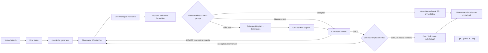

# Sketch to Walkthrough

**Drawn by you. Brought to life in the browser.**

An open-source Vite + React + Three.js app that turns a floor-plan sketch into an editable, walkable 3D home. Kimi reads the drawing and writes a small layout generator. A deterministic engine—not the vision model—checks its work.

The renderer is fixed. Kimi controls the layout, not your camera, browser, or Three.js scene.


## Run it

Requires Node.js 20.19+ or 22.12+ (tested on Node 24). No database.

```sh
npm install
cp .env.example .env   # add your NEBIUS_API_KEY
npm run dev
```

Open **http://localhost:5180**. The model server listens on **8787**. The Vite port is fixed so another local project won't silently receive requests.

```dotenv
NEBIUS_API_KEY=your_key_here
NEBIUS_BASE_URL=https://api.tokenfactory.nebius.com/v1
MODEL=moonshotai/Kimi-K3.1-Pro
PORT=8787
MODEL_REQUEST_TIMEOUT_MS=1200000

`.env` is gitignored. **The key is read only by `server/index.js`, never sent to the browser.** `.env.example` intentionally has no key. Images go from the browser to the local server, then to the configured model provider. There is no database or server-side disk storage of sketches; navigating away loses the session.

Three original generated PNG samples are included in `public/samples`. Click an image to run the complete model loop, or its round arrow for an instant local two-bedroom example. Regenerate sketches with `npm run samples` (local Playwright Chromium).

## The generate → check → render → review loop



1. **Generate.** `prompts/generate.md` requires a room-by-room inventory of every written dimension and schedule-table entry, exact unit conversion, the sketch's relative positions, and visible furniture before layout. The model exports exactly `PARAMS`, `ASSUMPTIONS`, and `buildPlan`; the returned `PlanSpec` carries written sizes, room openness, and sketch furniture as data.
2. **Build safely.** Each slider change or revision runs in a newly-created disposable module Web Worker. Acorn source validation allows pure computation, `Math`, and `Number`; imports, ambient network/DOM globals, dynamic code, prototype access, and mutation are rejected. The parent terminates a worker after **500 ms**.
3. **Repair, validate, furnish, and check.** Deterministic local repairs clamp out-of-range parameter defaults into their inclusive bounds and link or detach incomplete assumption references; every repair is listed on that version in Checks. Zod validates `PlanSpec`, including its furniture catalogue and written-size schedule. Optional auto-furnishing fills still-empty rooms by name, tries alternative placements, and drops a default rather than violate geometry or circulation. Independent checks cover the closed exterior, room geometry, written dimensions, openings, entry-to-room access, furniture, and 600 mm furniture-aware paths. Structural, execution, schema, and engineering failures go into review rather than being hidden by local repair.
4. **Render.** The fixed SVG plan builder draws fitted, wrapped and polygon-clipped room labels, clean furniture symbols, wall openings, door swings, and overall dimension lines. It is rasterised through a browser canvas to PNG for the vision reviewer; the plan tab displays the same SVG. Three.js uses the same catalogue geometry for dollhouse, walkthrough, and GLB export.
5. **Explore while review runs.** The first version that passes validation and all engineering checks opens immediately in the walkable viewer; the full-screen generation overlay no longer blocks it. `prompts/review.md` continues in the background with the original sketch, render, checks, and source. A valid revision joins the version switcher with a “newer version available” notice without changing the current camera or selected version. Invalid revisions remain inspectable while a valid earlier version stays navigable. The app keeps up to **three versions**, and a PASS permits **one optional refinement**.
6. **Explore and adjust.** Sliders rerun `buildPlan` locally. Walls, polygons, openings, and entry derive from the same numeric values. Assumptions link to their sliders. Versions and their in-session edits are switchable.

The server streams `POST {NEBIUS_BASE_URL}/chat/completions`. If a stream dies, it retries a zero-content response; when partial text exists, it asks the model to continue from that prefix. At most three attempts are made per call. `MODEL_REQUEST_TIMEOUT_MS` limits each attempt (default 1,200,000 ms), and the browser waits up to 1,500,000 ms. The debug panel shows actual returned completion tokens, elapsed time, and tokens/sec. It does not invent missing usage.

### Swap models with one env var

```dotenv
MODEL=another-vision-model-on-nebius
```

Restart the server. The replacement must support Nebius's OpenAI-compatible chat-completions format, streamed SSE, and `image_url` data-URL parts. `NEBIUS_BASE_URL` selects another compatible gateway. Generation uses `low` reasoning effort by default and review uses `medium`. Override them with `GENERATE_REASONING_EFFORT` and `REVIEW_REASONING_EFFORT` if a model needs a different setting. The generation prompt asks for compact, comment-free helpers and a focused parameter set, with an explicit keyed-object `PARAMS` example and written-only schedule entries. Review requests allow up to 40,000 completion/reasoning tokens so a full repaired courtyard-sized generator is not displaced by reasoning; this is a budget, not measured usage.

## Generator contract

All PlanSpec dimensions are **mm**, origin bottom-left, plan Y upward. Three.js geometry is in metres; plan Y maps to world −Z.

```js
export const PARAMS = {
  wall_height: { value: 2700, min: 2400, max: 3300, group: "global", label: "Wall height" },
  living_width: { value: 5000, min: 4000, max: 6000, group: "room", room: "living", label: "Living width" }
};
export const ASSUMPTIONS = [
  { id: "height", text: "No height was written; a residential default is used.", param: "wall_height" }
];
export function buildPlan(P) {
  // P is { wall_height: 2700, living_width: 5000 }.
  // Derive all geometry from P, never hardcode adjustable dimensions.
  return {
    wallHeight: P.wall_height,
    walls: [/* { id, a, b, thickness, exterior } */],
    rooms: [/* { id, name, polygon, floor, kind: "indoor"|"open"|"outdoor" } */],
    schedule: [/* { roomId, writtenWidth, writtenDepth, source: "label"|"schedule" } */],
    openings: [/* { id, wallId, type, offset, width, height, sill?, swing? } */],
    furniture: [/* { id, roomId, type, position, rotation, size?, source } */],
    entry: { position: [1000, 1200], facing: 0 }
  };
}
```

Bounds are inclusive: `min <= value <= max`, with `min < max` and positive minima. Up to 100 flat numeric parameter entries. Room parameters reference a room ID. `offset` is measured from a wall's `a` endpoint. Doors/openings connect room polygons; windows do not. Entry facing is clockwise degrees from north: `0` faces +Y, `90` faces +X.

Room `floor` is `wood`, `tile`, `carpet`, `concrete`, `paving`, `grass`, or `water`; `kind` defaults to `indoor`. `open` courtyards and `outdoor` terraces/pools/gardens never receive ceilings. Outdoor polygons may lie beyond the exterior loop. A water floor renders below the surrounding surface with coping generated around the pool polygon.

Written schedule values are millimetres. The size check compares polygon bounding width/depth in either orientation and accepts ±10% or ±150 mm, whichever is larger. Furniture positions are centres in plan millimetres, rotations are degrees, and optional `size: [width, depth]` overrides catalogue defaults. `source: "sketch"` is reserved for model-reconstructed items; deterministic additions use `source: "auto"`. The Dimensions panel's **Furnish empty rooms** switch removes/restores only auto items.

The fixed 25-type catalogue is: `bed_double`, `bed_single`, `nightstand`, `wardrobe`, `sofa`, `armchair`, `coffee_table`, `tv_unit`, `dining_table`, `kitchen_run`, `kitchen_island`, `fridge`, `toilet`, `basin_vanity`, `bathtub`, `shower`, `desk`, `bookshelf`, `washer`, `car`, `plant`, `tree`, `gym_bike`, `yoga_mat`, and `lounger`.

The prompts ask for realistic narrow ranges and coupled geometry, not redundant coordinate sliders. Invalid edits are exposed in Checks rather than silently distorting construction. `ASSUMPTIONS[].param` is optional: a missing reference is linked only when its name matches exactly one parameter; otherwise the assumption remains text-only. Original assumption text and values stay visible beside current slider values.

## Deterministic checks

- One connected exterior loop, degree two at corners. No duplicate, zero-length, intersecting, or overlapping walls; T-junctions are allowed.
- Simple, nonzero, non-self-intersecting room polygons; no overlapping rooms; indoor/open vertices inside the exterior envelope, with outdoor areas exempt.
- Every written schedule dimension matches its room's polygon within ±10% or ±150 mm (larger tolerance), in either orientation.
- Valid opening references, 100 mm minimum margin at both wall ends, no overlapping openings, no opening through the wall top.
- Doors at least 800 mm wide at floor level. Window sills between 600 and 1100 mm.
- Entry-to-room graph traversal through doors/openings. Rooms named hall/corridor/passage have a 900 mm clearance check.
- Every furniture ID and room reference is valid; every oriented footprint is inside its room, pair-overlap free, and clear of door swings and opening clear widths.
- A 200 mm-grid flood fill, with furniture and room boundaries expanded by 300 mm, checks a ≥600 mm route from each door into its furnished room.
- Min/max stored per parameter, with actual rebuild validation after edits.

These checks are for exploration, **not structural, building-code, fire-safety, accessibility, or construction certification**. Hallway checking is oriented toward straight rectangular halls; unusual concave corridors may be conservatively rejected.

## Viewer and exports

- **Plan:** dimensioned orthographic drawing with room-clipped labels and furniture symbols.
- **Dollhouse:** orbit/pan/zoom with roof off and hemisphere + directional shadow lighting. Labels use wrapped text, calculated interior anchors, room-limited world widths, and distance attenuation to reduce overlap; very large plans or narrow galleries may need zooming.
- **Walkthrough:** pointer lock, WASD/arrow keys, Shift to move faster, mouse look, Escape. Eye height **1600 mm**. A 210 mm body radius checks wall segments while allowing passage through door/opening clear spans, not windows. Spawn selection seeks roughly **1000 mm clear of wall surfaces**, faces into the selected room, and uses the existing collision test. If a narrow entry hall cannot provide that clearance, the nearest safe room is used instead. Labels use wall depth testing and are limited to the current room, with a smaller size cap to avoid adjacent-room overlap. Touch-move joystick and drag-to-look are included.
- Walls are solid segments around real holes; no CSG dependency. Glass, frames, ajar doors, per-room floor materials, and first-person ceilings derive from `PlanSpec`. Indoor ceilings are omitted for `open` and `outdoor` rooms. Low-poly furniture shares materials and geometry, with instanced dining chairs and plant foliage; it is included in GLB exports with type/source metadata. Blocking furniture footprints are part of first-person collision, while yoga mats are walkable.
- Downloads: metre-scaled GLB from `GLTFExporter`, `plan.json`, `plan.js` with current defaults substituted into the AST-identified `PARAMS` object, and `plan.svg`.

## Project map

```text
server/index.js           Hono routes, key handling, stream continuation, telemetry
prompts/                  Separate generation and review prompts
src/lib/plan.ts           Zod PlanSpec, parameters, assumptions
src/lib/module.ts         Acorn validation and generator evaluation
src/lib/plan.worker.ts    Disposable browser build sandbox
src/lib/checks.ts         Engineering, written-size, furniture and path checks
src/lib/furniture.ts      Catalogue defaults, collision geometry and auto-furnishing
src/lib/furniture-world.ts Shared low-poly Three.js furniture builders
src/lib/furniture-svg.ts  Orthographic furniture symbols
src/lib/label-layout.ts   Room-interior anchors and fitted/wrapped labels
src/lib/plan-svg.ts       Orthographic SVG and canvas PNG rasterisation
src/lib/world.ts          Three.js rooms, open/pool surfaces, walls and furniture
src/three/PlanViewer.tsx  View modes, input, label sizing and camera
src/lib/walkthrough.ts     Collision, safe spawn selection and sight-line facing
src/App.tsx               Model/version orchestration and studio
public/samples/           Three original generated sketch PNGs
scripts/browser-check.mjs Full-Chromium browser checks
scripts/model-check.mjs   Real, unmocked end-to-end model verification
scripts/generation-check.mjs Real generation checks on all three samples
```

## Tests and verification commands

```sh
npm test              # Validator, sandbox restrictions, checks, slider bounds
npm run build         # TypeScript and production Vite build
npm run qa            # Start npm run dev first; browser evidence in screenshots/
npm run verify:model       # REAL two-bedroom generate/review loop; NEBIUS_API_KEY required
npm run verify:generation  # REAL generation-only checks on all three samples
SAMPLE_IMAGE=samples/user/courtyard-house.png npm run verify:model  # REAL courtyard loop
EVIDENCE_PREFIX=two-bedroom MODEL_EVIDENCE=two-bedroom-third-pass-verification.json npm run verify:model
```

QA prefers `~/Library/Caches/ms-playwright/chromium-1234/chrome-mac-arm64/Google Chrome for Testing.app`, falling back to Playwright's browser lookup. It uses full Chromium, not headless-shell. Screenshots and evidence stay in gitignored `screenshots/`. Unit tests never call the model. The real verification script drives the user-facing generate/review flow and records returned code, verdicts, issues, usage, and total time without mocking.

## Verification

### Checked locally

- `npm test`: **74 tests passed**, covering PlanSpec and source rejection, parameter bounds and repairs, original wall/polygon/opening/access cases, written-size tolerances and orientation, open/outdoor rules, every furniture check, auto-placement, provenance, labels, and furniture collision.
- `npm run build`: TypeScript and the production Vite build passed.
- Full-Chromium desktop and mobile screenshots were captured at **1440, 1280, and 390 px**. Hero annotation overlap checks passed at all three sizes.
- The final desktop/mobile browser run passed **51/51 checks**: three modes, wall-occluded walkthrough labels, parameter-driven geometry, movement and pointer-lock release, mobile joystick, assumptions, repairs, versions, downloads, overflow, all 25 furniture builders, instancing, open/outdoor ceilings, recessed pool/coping, auto-furnish switching, and furniture collision.
- Browser-only mocked model responses proved that v1 is visible and usable before review returns, local repairs are shown in Checks, and a revised v2 appears without switching away from the v1 walkthrough. These checks do not call the real model.
- Sample worker builds measured **10.0–11.5 ms** in the final run, excluding browser rendering/automation. A deliberately non-terminating generator was killed at **502.2 ms**.
- After all slider extremes and the furnishing pass, the sample spawned in Living Room with **1100 mm** clearance from the nearest wall surface and **1200 mm** to its centreline, beyond the 900 mm browser-check threshold.
- Downloaded `.glb` was checked for its binary glTF signature and contained **15 furniture nodes** with catalogue types and source metadata. `.json`, `.js`, and `.svg` downloads were saved, and the exported plan contained edited geometry and furniture symbols.

### Third-pass courtyard-house result

The real courtyard run used the uploaded image, Kimi generation, and three versions/review rounds. Earlier real responses were replayed to resume failed streams without regenerating the source; those responses are marked `reused: true` in the evidence and are not counted as new calls. Counting the captured generation and review plus the two subsequent reviews gives **four actual model responses**. **Combined model-sequence time: 1770.7 s (about 29 min 31 s). A first fully walkable version was not reached.** This combined sequence excludes the abandoned earlier timeout/retry waits, which are preserved in `courtyard-initial-timeout.json` and `courtyard-verification.json`.

| Phase | API seconds | Completion tokens (reasoning) | Tokens/sec | Outcome |
|-------|-------------|-------------------------------|------------|---------|
| Generate | 444.06 | 15,730 (8,114) | 35.4 | V1: unkeyed `PARAMS`; undefined `pantryY` |
| Review v1 | 534.85 | 992 (608) | 1.9 | V2 built, with geometry/access/furniture failures |
| Review v2 | 392.10 | 37,986 (24,704) | 96.9 | V3: geometry and access repaired; furniture failures remain |
| Review v3 | 394.82 | 30,653 (17,422) | 77.6 | REVISE: pool-deck, media-room and terrace placement |

V3 has **38 rooms/spaces, 68 walls, 63 openings, 76 sketch-sourced furniture items and 0 auto items**, including the circulation, decks and garden links added during review. Five of six engineering groups pass: structure/walls, room geometry, written sizes, openings and reachability. The courtyard is `kind: "open", floor: "paving"` with no ceiling, and there are eight additional open/outdoor spaces, including paving terrace/decks, grass gardens and a recessed water pool with coping. The pool and gardens are reachable. The remaining **Furniture & circulation** failures are three pool-deck loungers outside a deck or obstructing openings, no 600 mm paths around narrow-deck loungers, media-room door access, and terrace furniture circulation. The viewer still permits inspection of v3, but it is **not counted as an engineering-passing walkthrough**.

| Room / written source | Written width × depth (mm) | Generated width × depth (mm) | Size check |
|---|---:|---:|:---:|
| Great Room | 6200 × 5800 | 6200 × 5800 | Pass |
| Dining | 4200 × 3800 | 4200 × 3800 | Pass |
| Kitchen | 4200 × 4400 | 4200 × 4400 | Pass |
| Pantry | 2200 × 2400 | 2200 × 2400 | Pass |
| Primary Suite | 5600 × 4200 | 5600 × 4200 | Pass |
| Dressing | 3600 × 2400 | 3600 × 2400 | Pass |
| Primary Ensuite | 4600 × 3000 | 4600 × 3000 | Pass |
| Bed 02 | 4000 × 3600 | 4000 × 3600 | Pass |
| Bed 03 | 4000 × 3600 | 4000 × 3600 | Pass |
| Shared Bath | 3000 × 2400 | 3000 × 2400 | Pass |
| Guest Bedroom | 3600 × 3600 | 3600 × 3600 | Pass |
| Guest Ensuite | 2000 × 2400 | 2000 × 2400 | Pass |
| Study / Library | 4600 × 3600 | 4600 × 3600 | Pass |
| Media Room | 4600 × 3200 | 4600 × 3200 | Pass |
| Gym / Yoga | 4600 × 3600 | 4600 × 3600 | Pass |
| Laundry / Mudroom | 3400 × 2400 | 3400 × 2400 | Pass |
| Utility / Storage | 2600 × 3200 | 2600 × 3200 | Pass |
| Powder Room | 1800 × 2000 | 1800 × 2000 | Pass |
| Two-car Garage | 5600 × 5800 | 5600 × 5800 | Pass |
| Courtyard (open to sky) | 7000 × 6000 | 7000 × 6000 | Pass |
| Entry Foyer | 3600 × 3200 | 3600 × 3200 | Pass |
| Covered Terrace | 12000 × 2400 | 12000 × 2400 | Pass |
| Pool | 8000 × 3000 | 8000 × 3000 | Pass |

The supplied before image reports **40.4 m² for Bed 02, 19.1 m² for Shared Bath and 17.1 m² for Dressing**. The final generated areas are **14.4 m², 7.2 m² and 8.64 m²**, respectively. The former uniform grid is replaced by dimension-driven, non-uniform rooms; the enclosed-before courtyard is open; and the pool, terrace and landscaping are present. The final plan also has fitted, room-clipped labels and clean furniture symbols. Clearance defects and imperfect furniture placement remain, so this is a substantial **layout-fidelity improvement, not a fully passing reconstruction**.

Evidence: `screenshots/courtyard-final-verification.json`, `courtyard-final-plan.json`, `courtyard-after-plan.png`, `courtyard-dollhouse.png`, and `courtyard-walkthrough.png`. Final rendering was also replayed offline as `courtyard-final-fixed-*`; replay makes no model calls and does not change review verdicts. The stateful v3 plan remained `REVISE`; no fourth version was applied.

### Third-pass real two-bedroom regression

Tested with `moonshotai/Kimi-K3.1-Pro` on the original two-bedroom sample, concurrently with the courtyard generation. Four real requests produced three versions. V1 had an invalid parameter-array shape and v2 used schedule sources outside the enum; v3 became walkable and passed all six engineering groups. **First walkable: 274.4 s wall / 270.9 s app. Total: 568.7 s wall.** The two-minute first-walkable target was therefore not met in this run.

| Call | API seconds | Completion tokens (reasoning) | Tokens/sec | Result |
|------|-------------|-------------------------------|------------|--------|
| Generate v1 | 48.35 | 6,710 (4,382) | 138.8 | Invalid `PARAMS` array |
| Review v1 | 135.16 | 16,808 (14,034) | 124.4 | REVISE; corrected parameter shape |
| Review v2 | 87.04 | 8,102 (5,432) | 93.1 | REVISE; corrected schedule sources |
| Review v3 | 294.4 | 14,299 (11,553) | 48.6 | Valid v3; REVISE observations remain |

V3's four schedule entries had exact generated bounding dimensions: kitchen **5500 × 3300**, living **5500 × 3900**, Bed 01 **3800 × 3100**, and Bed 02 **3800 × 4100 mm**. All passed the deterministic size check. It included **6 sketch-sourced furniture items and 0 auto items**. The final reviewer still identified an exterior depth enlarged by wall thicknesses, beds rotated from the sketch, and a shifted Bed 02 door. Its suggested code would require a fourth version, which the three-version limit does not apply. Thus this run is an engineering pass, **not a clean vision PASS**. Evidence: `screenshots/two-bedroom-third-pass-verification.json` and the `two-bedroom-*` captures.

### Reasoning-effort check (real generation calls)

Generation-only runs used all three original sample PNGs and executed the returned source through the actual builder. `none` returned zero reasoning tokens and much smaller modules, but none of these three final `none` responses passed every engineering check. `low` passed all three after replay through the corrected helper-scope validator. This is why the default remains **low**, not `none`.

| Effort | Sample | API time | Completion tokens (reasoning) | Tokens/sec | Builder + engineering result |
|--------|--------|----------|-------------------------------|------------|------------------------------|
| none | two-bedroom | 121.6s | 2,113 (0) | 17.4 | Door margin and reachability failures |
| none | studio | 23.9s | 1,800 (0) | 75.3 | Room reachability failure |
| none | garden-flat | 25.7s | 1,915 (0) | 74.6 | Overlapping windows |
| low | two-bedroom | 80.0s | 5,645 (3,729) | 70.6 | All four check groups passed |
| low | studio | 59.7s | 4,714 (3,126) | 79.0 | All four check groups passed |
| low | garden-flat | 77.4s | 5,577 (3,651) | 72.1 | All four check groups passed |

The replay was offline and used the final Acorn scope handling; it corrected false rejections of pure named/private helpers without allowing assignments, default parameters, or ambient globals. Evidence: `screenshots/generation-verification.json`, `screenshots/generation-none-final.json`, and `screenshots/generation-replay.json`. Replay with `node --experimental-strip-types scripts/replay-generation.ts`; it makes no model requests.

### Earlier two-bedroom baseline (before the third pass)

Tested on 2026-11-05 with `moonshotai/Kimi-K3.1-Pro` on Nebius Token Factory, reading the **two-bedroom sample sketch**. Three real requests produced two retained versions. Generation used `low`; both reviews used `medium`.

| Call | Phase | API duration | Completion tokens (reasoning) | Tokens/sec | Result |
|------|-------|--------------|-------------------------------|------------|--------|
| 1 | Generate v1 | 127.4s | 7,570 (5,710) | 59.4 | Valid v1; all four engineering groups passed and the viewer opened before review |
| 2 | Review v1 | 310.6s | 16,766 (14,526) | 54.0 | REVISE: door positions/swings and window placement observations |
| 3 | Review v2 | 208.5s | 5,362 (5,334) | 25.7 | **PASS**, no remaining issues or improvements |

**Time to first walkable:** **127.9s app time / 131.0s wall time**. This was v1, before its vision review completed. **Time to final v2:** **650.5s wall time** (about 10 minutes 51 seconds); the three API calls account for **646.5s** of that flow. The two medium reviews account for **519.1s**, so background review dominates final completion time. The version-2 state and screenshots report a rounded **647s** in the app footer.

The 2-minute first-walkable target remains **not met** in this run: it exceeded 120 seconds by **7.9s app time / 11.0s wall time**. Generation dominates first availability; medium review dominates total refinement time. Later valid revisions do not interrupt the current walkthrough.

`model-verification.json` stores the full real API responses, reasoning settings, first/final timings, and both version states. `replay-verification.json` independently replays both modules through the current builder and engineering checks with no network requests: both have five rooms, 15 parameters, eight assumptions, no required repairs, and all four check groups passing. `live-first-walkable.png`, `live-final-dollhouse.png`, `live-final-walkthrough.png`, and the per-version plan/check screenshots were opened and visually inspected. Replay with `node --experimental-strip-types scripts/replay-live.ts`.

### Current limits

- Results depend on sketch legibility and model interpretation. Mirror writing, faint text, missing walls, and ambiguous topology may need revision; inspect assumptions.
- Vision review is not proof of faithfulness. Deterministic checks establish consistency, not agreement with every pencil line. The model authors the schedule, so an omitted written dimension cannot be recovered by geometry checks alone. The three-version cap can leave valid but visually imperfect plans and an unapplied final reviewer suggestion.
- Furniture uses fixed catalogue types and rectangular oriented footprints. Any drawn object without a catalogue equivalent needs approximation. Defaults avoid detected conflicts and are dropped if no safe placement works; unsafe sketch-derived placements are reported rather than silently removed or moved. The courtyard v3 retains pool/media/terrace placement failures.
- No curved walls, multistorey layouts, stairs, roofs, services, or professional architectural analysis.
- Safe slider combinations depend on the generator deriving coupled geometry and supplying useful bounds. Invalid combinations are reported; there is no general-purpose constraint solver.
- Generated code is source-restricted and run in a disposable worker, but this is not a hardened security boundary for arbitrary user-supplied untrusted code.
- Collision includes wall segments and blocking catalogue furniture footprints, not decorative sub-meshes, door panels, or non-rectangular object contours. Yoga mats are intentionally walkable. Doors remain visually ajar as you move.
- Model latency varies substantially. The third-pass two-bedroom first walkable took 270.9 s app time. Courtyard had no engineering-passing walkable version within three versions; its generation-plus-three-review sequence took 1770.7 s. Generation uses `low` and review uses `medium`; the two-minute target was not met. The local sample is the instant offline demonstration. Sessions do not persist across reloads.
- Safe spawn selection prefers the entry room but moves to the nearest room with adequate clearance when a narrow entry hall cannot provide it. Extremely tight geometry may not contain a point satisfying the 900–1000 mm target.

## License

MIT — see [LICENSE](LICENSE). Use generated layouts as a starting point for exploration, not as construction documents.
