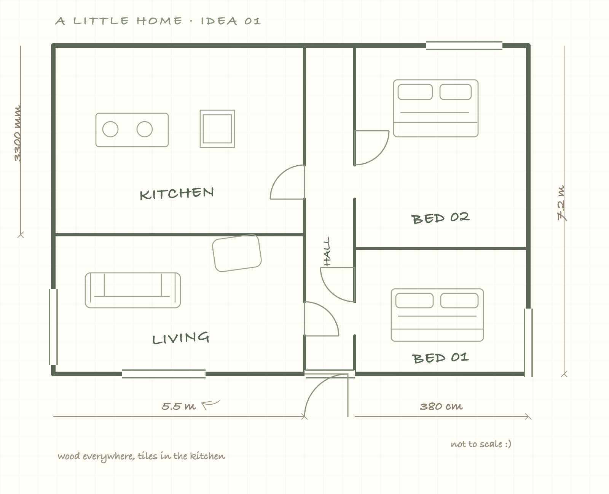
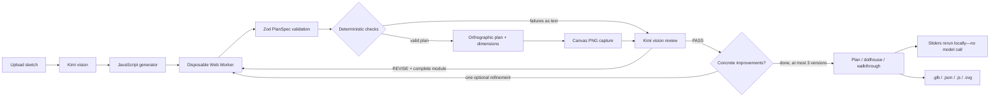

# Sketch to Walkthrough

**Drawn by you. Brought to life in the browser.**

An open-source Vite + React + Three.js app that turns a floor-plan sketch into an editable, walkable 3D home. Kimi reads the drawing and writes a small layout generator. A deterministic engine—not the vision model—checks its work.

The renderer is fixed. Kimi controls the layout, not your camera, browser, or Three.js scene.



## Run it

Requires Node.js 20.19+ or 22.12+ (tested on Node 24). No database.

```sh
npm install
cp .env.example .env   # add your NEBIUS_API_KEY
npm run dev
```

Open **http://localhost:5180**. The model server listens on **8787**. The Vite port is fixed so another local project won't silently receive requests.

```dotenv
NEBIUS_API_KEY=your_key_here
NEBIUS_BASE_URL=https://api.tokenfactory.nebius.com/v1
MODEL=moonshotai/Kimi-K3.1-Pro
PORT=8787
```

`.env` is gitignored. **The key is read only by `server/index.js`, never sent to the browser.** `.env.example` intentionally has no key. Images go from the browser to the local server, then to the configured model provider. There is no database or server-side disk storage of sketches; navigating away loses the session.

Three original generated PNG samples are included in `public/samples`. Click an image to run the complete model loop, or its round arrow for an instant local two-bedroom example. Regenerate sketches with `npm run samples` (local Playwright Chromium).

## The generate → check → render → review loop



1. **Generate.** `prompts/generate.md` instructs the vision model to read written dimensions, convert to millimetres, and export exactly `PARAMS`, `ASSUMPTIONS`, and `buildPlan`.
2. **Build safely.** Each slider change or revision runs in a newly-created disposable module Web Worker. Acorn source validation allows pure computation, `Math`, and `Number`; imports, ambient network/DOM globals, dynamic code, prototype access, and mutation are rejected. The parent terminates a worker after **500 ms**.
3. **Validate and check.** Zod validates `PlanSpec`. Independent checks cover the closed exterior, room geometry, openings, and entry-to-room access. Failure text goes into review even if execution or schema validation failed.
4. **Render.** The fixed SVG plan builder draws the orthographic plan, room names and areas, wall openings, door swings, and overall dimension lines. It is rasterised through a browser canvas to PNG for the vision reviewer; the plan tab displays the same SVG.
5. **Review.** `prompts/review.md` receives original sketch, render, checks, and source, requiring JSON with `verdict`, `issues`, `improvements`, and optionally `code`. The app keeps up to **three versions**. A PASS permits **one optional refinement** if concrete improvements and a revised module are returned. An invalid revision is inspectable while a valid earlier version remains navigable.
6. **Explore and adjust.** Sliders rerun `buildPlan` locally. Walls, polygons, openings, and entry derive from the same numeric values. Assumptions link to their sliders. Versions and their in-session edits are switchable.

The server streams `POST {NEBIUS_BASE_URL}/chat/completions`. If a generation stream dies, it sends the partial answer and asks the model to continue, for up to three stream segments. The debug panel shows actual returned completion tokens, elapsed time, and tokens/sec. It does not invent missing usage.

### Swap models with one env var

```dotenv
MODEL=another-vision-model-on-nebius
```

Restart the server. The replacement must support Nebius's OpenAI-compatible chat-completions format, streamed SSE, and `image_url` data-URL parts. `NEBIUS_BASE_URL` selects another compatible gateway. Generation currently uses `low` reasoning effort to reduce latency; review uses `medium` in `server/index.js`.

## Generator contract

All PlanSpec dimensions are **mm**, origin bottom-left, plan Y upward. Three.js geometry is in metres; plan Y maps to world −Z.

```js
export const PARAMS = {
  wall_height: { value: 2700, min: 2400, max: 3300, group: "global", label: "Wall height" },
  living_width: { value: 5000, min: 4000, max: 6000, group: "room", room: "living", label: "Living width" }
};
export const ASSUMPTIONS = [
  { id: "height", text: "No height was written; a residential default is used.", param: "wall_height" }
];
export function buildPlan(P) {
  // P is { wall_height: 2700, living_width: 5000 }.
  // Derive all geometry from P, never hardcode adjustable dimensions.
  return {
    wallHeight: P.wall_height,
    walls: [/* { id, a, b, thickness, exterior } */],
    rooms: [/* { id, name, polygon, floor } */],
    openings: [/* { id, wallId, type, offset, width, height, sill?, swing? } */],
    entry: { position: [1000, 1200], facing: 0 }
  };
}
```

`min < value < max` strictly. Up to 100 flat numeric parameter entries. Room parameters reference a room ID. `offset` is measured from a wall's `a` endpoint. Doors/openings connect room polygons; windows do not. Entry facing is clockwise degrees from north: `0` faces +Y, `90` faces +X.

The prompts ask for realistic narrow ranges and coupled geometry, not redundant coordinate sliders. Invalid edits are exposed in Checks rather than silently distorting construction.

## Deterministic checks

- One connected exterior loop, degree two at corners. No duplicate, zero-length, intersecting, or overlapping walls; T-junctions are allowed.
- Simple, nonzero, non-self-intersecting room polygons; no overlapping rooms; vertices inside the exterior envelope.
- Valid opening references, 100 mm minimum margin at both wall ends, no overlapping openings, no opening through the wall top.
- Doors at least 800 mm wide at floor level. Window sills between 600 and 1100 mm.
- Entry-to-room graph traversal through doors/openings. Rooms named hall/corridor/passage have a 900 mm clearance check.
- Min/max stored per parameter, with actual rebuild validation after edits.

These checks are for exploration, **not structural, building-code, fire-safety, accessibility, or construction certification**. Hallway checking is oriented toward straight rectangular halls; unusual concave corridors may be conservatively rejected.

## Viewer and exports

- **Plan:** dimensioned, labelled orthographic drawing.
- **Dollhouse:** orbit/pan/zoom with roof off, hemisphere + directional shadow lighting, floating room-label toggle.
- **Walkthrough:** pointer lock, WASD/arrow keys, Shift to move faster, mouse look, Escape. Eye height **1600 mm**. A 210 mm body radius checks wall segments while allowing passage through door/opening clear spans, not windows. Touch-move joystick and drag-to-look are included.
- Walls are solid segments around real holes; no CSG dependency. Glass, frames, ajar doors, per-room floor materials, and first-person ceilings derive from `PlanSpec`.
- Downloads: metre-scaled GLB from `GLTFExporter`, `plan.json`, `plan.js` with current defaults substituted into the AST-identified `PARAMS` object, and `plan.svg`.

## Project map

```text
server/index.js           Hono routes, key handling, stream continuation, telemetry
prompts/                  Separate generation and review prompts
src/lib/plan.ts           Zod PlanSpec, parameters, assumptions
src/lib/module.ts         Acorn validation and generator evaluation
src/lib/plan.worker.ts    Disposable browser build sandbox
src/lib/checks.ts         Deterministic engineering checks
src/lib/plan-svg.ts       Orthographic SVG and canvas PNG rasterisation
src/lib/world.ts          Three.js walls, openings, floors, doors, glass, labels
src/three/PlanViewer.tsx  View modes, input and collision
src/App.tsx               Model/version orchestration and studio
public/samples/           Three original generated sketch PNGs
scripts/browser-check.mjs Full-Chromium browser checks
scripts/model-check.mjs   Real, unmocked end-to-end model verification
```

## Tests and verification commands

```sh
npm test              # Validator, sandbox restrictions, checks, slider bounds
npm run build         # TypeScript and production Vite build
npm run qa            # Start npm run dev first; browser evidence in screenshots/
npm run verify:model  # REAL model requests; working NEBIUS_API_KEY required
```

QA prefers `~/Library/Caches/ms-playwright/chromium-1234/chrome-mac-arm64/Google Chrome for Testing.app`, falling back to Playwright's browser lookup. It uses full Chromium, not headless-shell. Screenshots and evidence stay in gitignored `screenshots/`. Unit tests never call the model. The real verification script drives the user-facing generate/review flow and records returned code, verdicts, issues, usage, and total time without mocking.

## Verification

### Checked locally

- `npm test`: **36 tests passed**, including Zod rejection, global and constructor access restrictions, fence extraction, invalid wall/polygon/opening cases, disconnected rooms, entry and clearance checks, all sample parameter bounds, and accumulated minima/maxima.
- `npm run build`: TypeScript and the production Vite build passed.
- Full-Chromium desktop and mobile screenshots were captured and visually inspected. Initial dollhouse clipping, lighting, and the sample hall minimum were corrected.
- Browser tests covered three modes, room labels, parameter-driven plan changes, movement and pointer-lock release, an on-screen joystick, assumptions sliders, downloads, and mobile overflow.
- Sample worker builds measured around **10–13 ms** per change. This excludes browser rendering/automation; larger motion-and-query timings occurred while two software-WebGL sessions shared the machine.
- A deliberately non-terminating generator was killed at **500.9 ms** in an actual browser worker. The final desktop/mobile browser run passed **32/32 checks**.
- Downloaded `.glb` was checked for its binary glTF signature. `.json`, `.js`, and `.svg` downloads were saved, and the exported plan contained edited geometry.

### Real model verification

Tested on 2026-11-05 with `moonshotai/Kimi-K3.1-Pro` on Nebius Token Factory, reading the **two-bedroom sample sketch**. Four real model requests were made to complete a generate→check→render→review→revise loop across **three versions**.

| Call | Model phase | Completion tokens | Tokens/sec | Duration | Verdict |
|------|------------|-------------------|------------|----------|---------|
| 1 | Generate v1 | 5,825 | 43.6 | 133.7s | Zod rejected a parameter bound |
| 2 | Review v1 | 6,083 | 34.8 | 175.0s | REVISE: `window_height` value equals its max (schema validation failure) |
| 3 | Review v2 | 11,342 | 33.2 | 341.7s | REVISE: ASSUMPTIONS[7] lacks required `param` field; door/window placement issues |
| 4 | Review v3 | 4,751 | 16.7 | 284.1s | **PASS** — vision review passed, all four engineering checks passed |

Three returned modules were retained as versions. Offline replay of the captured responses through the actual worker validation/check code confirmed: **v1 failed** the parameter-bound rule, **v2 failed** the assumption-link rule, and **v3 passed** all four engineering checks. Only v3 produced a valid PlanSpec. Total time measured by the app: **~15.6 minutes (~936s)** (945.5s including browser startup/automation) for four sequential model calls.

Captured evidence: `screenshots/model-verification.json` stores the full real API responses; `screenshots/replay-verification.json` has the independent build/check outcome for the three returned modules. `live-final-dollhouse.png`, `live-final-walkthrough.png`, and the v3 screenshots show the validated generated plan. All were opened and visually inspected: five correctly named rooms, labelled polygons, dimension lines, 15 parameters, 8 assumptions, and three retained version tabs. The initial verifier screenshot capture missed pointer-lock release before the debug step; that script was fixed. Offline replay is repeatable with `node --experimental-strip-types scripts/replay-live.ts` and makes no network requests.

The 2-minute target is **not met** on this endpoint: each generate/review call takes 2–6 minutes depending on reasoning_effort and prompt size. Slider moves after generation rebuild locally in ~10–13 ms well within the 200 ms target. For faster iteration, reduce `max_tokens` in the generation prompt (see `server/index.js` line 22) or lower the review model's reasoning_effort.

### Current limits

- Results depend on sketch legibility and model interpretation. Mirror writing, faint text, missing walls, and ambiguous topology may need revision; inspect assumptions.
- Vision review is not proof of faithfulness. Deterministic checks establish consistency, not agreement with every pencil line.
- No furniture reconstruction, curved walls, multistorey layouts, stairs, roofs, services, or professional architectural analysis.
- Safe slider combinations depend on the generator deriving coupled geometry and supplying useful bounds. Invalid combinations are reported; there is no general-purpose constraint solver.
- Generated code is source-restricted and run in a disposable worker, but this is not a hardened security boundary for arbitrary user-supplied untrusted code.
- Collision includes wall segments, not door panels or furniture. Doors remain visually ajar as you move.
- Model latency varies. The local sample is the instant offline demonstration. Sessions do not persist across reloads.

## License

MIT — see [LICENSE](LICENSE). Use generated layouts as a starting point for exploration, not as construction documents.
